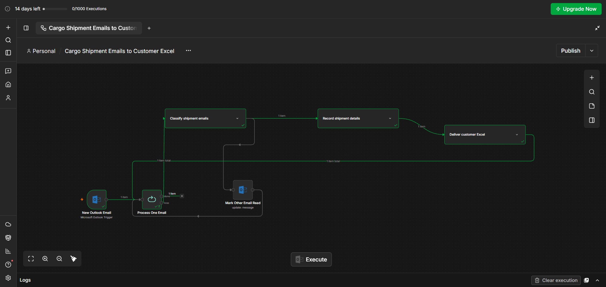
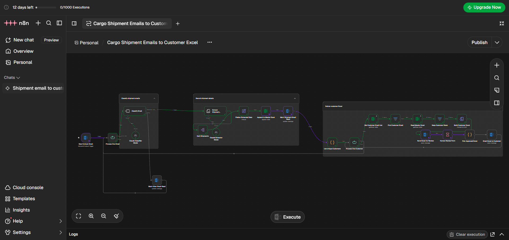
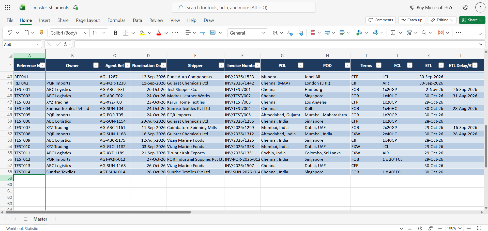
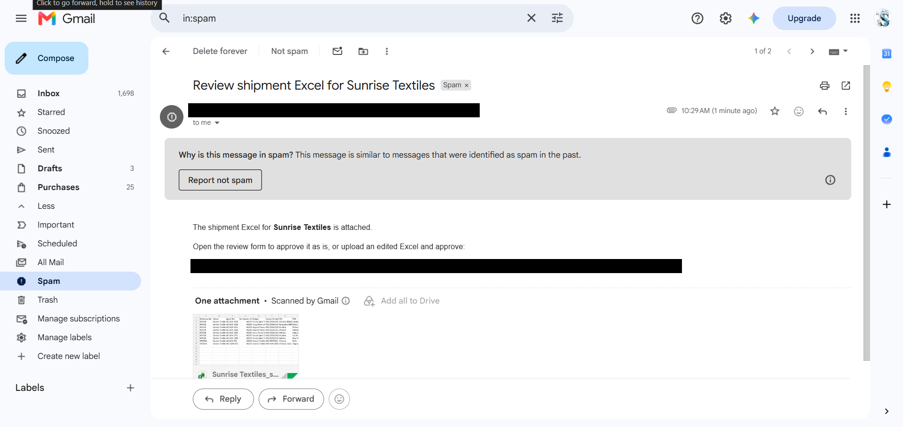
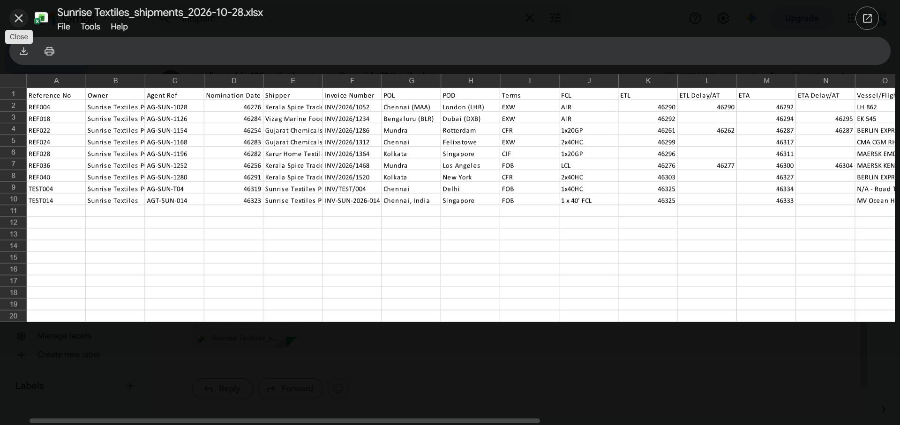
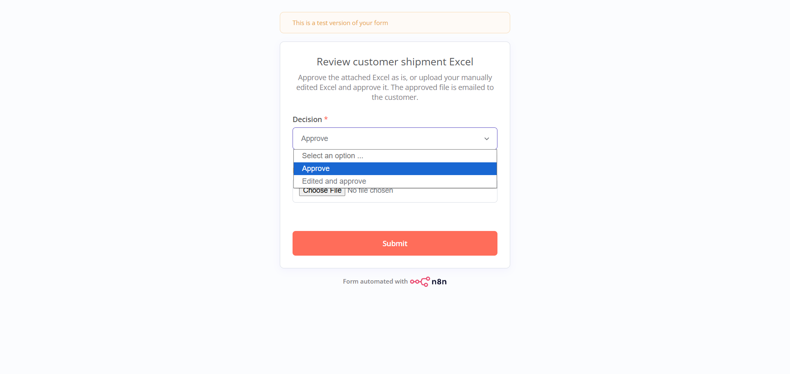
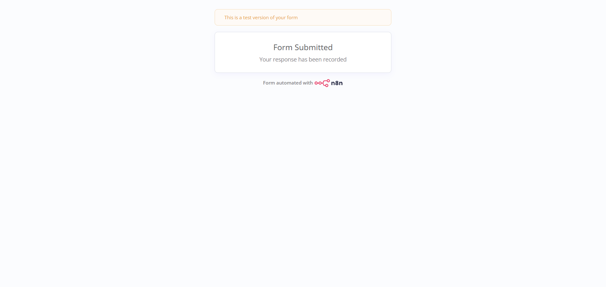
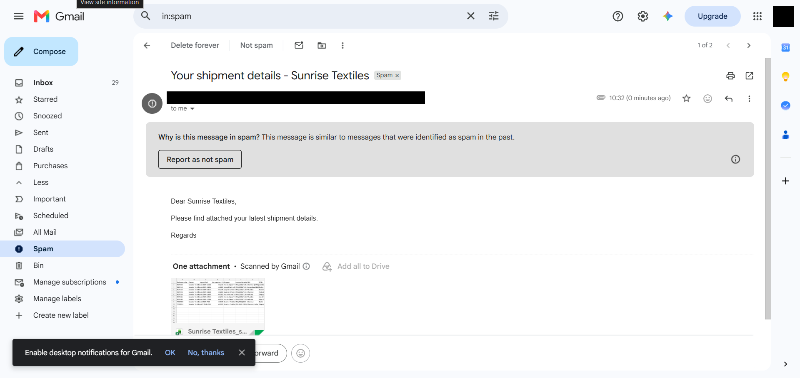

# Cargo Shipment Email Tracking and Automation

An [n8n](https://n8n.io) workflow that reads incoming shipment emails from Microsoft Outlook, uses Claude AI to classify them and extract shipment details, stores every shipment in a master Microsoft Excel table, and sends each customer their own shipment report after a person has reviewed and approved it.

## Overview

Freight and cargo teams receive many emails about bookings, bills of lading, containers, vessels and ETAs. This workflow turns those unstructured emails into structured shipment records and customer-ready Excel reports. It keeps a human reviewer in the loop before anything is sent to a customer.

The workflow file is [`workflow/cargo-email-automation.json`](workflow/cargo-email-automation.json).

## Problem statement

Shipment updates usually arrive as free-text emails, often with several shipments for different customers in one message. Copying these details into a tracking sheet by hand and then preparing a separate report for each customer is slow, repetitive and error-prone. This workflow automates the classification, data entry and report preparation, and leaves the final approval to a person.

## Technologies used

All of these are used by nodes in the workflow:

| Technology | Used for |
|---|---|
| **n8n** | Workflow orchestration (triggers, loops, filters, code nodes, the wait/form step) |
| **Microsoft Outlook** | Polling for unread emails, marking emails as read, sending review and customer emails |
| **Claude AI (Anthropic)** | Email classification and structured data extraction (model `claude-haiku-5-5`, through n8n's LangChain nodes) |
| **Microsoft Excel (Microsoft 365)** | Master shipment table and the customer contact list |

## Workflow architecture

The workflow has 22 nodes in three groups.

```text
 New Outlook Email (every 5 min, unread only)
            │
            ▼
 ┌──► Process One Email (loop) ─────────────────────────────────────────┐
 │          │                                                           │
 │          ▼                                                           │
 │   Classify Email (Claude) ──"Other"──► Mark Other Email Read ────────┤
 │          │ "Shipment Cargo Information"                              │
 │          ▼                                                           │
 │   Extract Shipment Details (Claude)                                  │
 │          ▼                                                           │
 │   Split Shipments ─► Flatten Extracted Data ─► Append to Master Excel│
 │          ▼                                                           │
 │   Mark Shipment Email Read ─► List Unique Customers                  │
 │          ▼                                                           │
 │   ┌─► Process One Customer (loop) ── done ───────────────────────────┘
 │   │      │
 │   │      ▼
 │   │  Get Customer Email List ─► Find Customer Email ─► Read Master Excel
 │   │      ▼
 │   │  Keep Customer Rows ─► Build Customer Excel ─► Send Excel for Review
 │   │      ▼
 │   │  Human Review Form (wait) ─► Pick Approved Excel ─► Email Excel to Customer
 │   └──────┘
 └── (next email)
```

| Group | Nodes | Purpose |
|---|---|---|
| Classify shipment emails | Classify Email, Claude Classifier Model | Decide whether an email contains shipment/cargo information |
| Record shipment details | Extract Shipment Details, Claude Extractor Model, Split Shipments, Flatten Extracted Data, Append to Master Excel, Mark Shipment Email Read | Extract every shipment and add it to the master Excel table |
| Deliver customer Excel | List Unique Customers, Process One Customer, Get Customer Email List, Find Customer Email, Read Master Excel, Keep Customer Rows, Build Customer Excel, Send Excel for Review, Human Review Form, Pick Approved Excel, Email Excel to Customer | Build, review and send a per-customer report |

## Step-by-step workflow execution

1. **Trigger:** `New Outlook Email` polls the mailbox every 5 minutes for **unread** emails.
2. **One email at a time:** `Process One Email` loops through the new emails one by one.
3. **Classify:** `Classify Email` sends the subject and body preview to Claude and routes the email to one of two categories.
4. **Not a shipment email:** the email is marked as read (`Mark Other Email Read`) and the loop moves on to the next email.
5. **Shipment email:** `Extract Shipment Details` sends the subject and full body to Claude, which returns a list of shipments.
6. **Store:** each shipment becomes its own row (`Split Shipments`, `Flatten Extracted Data`) and is appended to the master Excel table.
7. **Mark read:** the source email is marked as read once.
8. **Per customer:** `List Unique Customers` collects the distinct owners (case-insensitive) found in this email, and `Process One Customer` loops through them.
9. **Build report:** for each customer, the workflow looks up their email address, reads the master table, keeps that customer's rows and converts them into an `.xlsx` file named `<Customer>_shipments_<yyyy-MM-dd>.xlsx` (sheet `Shipments`).
10. **Review:** the file is emailed to a reviewer with a link to a review form, and the workflow pauses.
11. **Approve and send:** after the reviewer submits the form, the approved file is emailed to the customer. The loop then continues with the next customer, and after that the next email.

## Email classification and shipment data extraction

**Classification** uses n8n's *Text Classifier* node with Claude and two categories:

- **Shipment Cargo Information:** emails with shipment, cargo, freight, booking, bill of lading, container, vessel, ETA/ETD or tracking information for a customer.
- **Other:** anything else.

**Extraction** uses n8n's *Information Extractor* node with Claude and a manual JSON schema. A single email can contain several shipments, including shipments for different customers, and each one is extracted separately. Only `owner` is required. The fields are:

| Excel column | Meaning |
|---|---|
| Owner | Customer / owner the shipment belongs to |
| Reference No | Reference number |
| Agent Ref | Agent reference |
| Nomination Date | Nomination date |
| Shipper | Shipper name |
| Invoice Number | Invoice number |
| POL | Port of loading |
| POD | Port of discharge |
| Terms | Shipping terms (FOB, CFR, CIF, …) |
| FCL | Container count and type, e.g. `1x20GP` |
| ETL | Estimated time of loading / departure |
| ETA | Estimated time of arrival |
| Vessel/Flight | Vessel or flight name and voyage |
| Routing | Routing |
| HBL/HAWB | House bill of lading / air waybill number |
| Surrender Status | Surrender status of the bill of lading |
| Container Number | Container number(s) |
| Carrier/Airline | Carrier or airline |
| Final HBL Send | Whether the final HBL has been sent (Yes/No) |
| Status | Current shipment status |
| Remarks | Remarks or notes |

## Master Excel storage and customer-specific report generation

The workflow uses two Excel tables in Microsoft 365 (OneDrive/SharePoint):

1. **Master shipment table:** every extracted shipment is appended here with *auto-map*, so the table's column headers must exactly match the 21 column names above.
2. **Customer email list:** a table with at least an `Owner` column and an `Email` column. Several addresses can be put in one cell separated by `;`, and the workflow converts them to a comma-separated recipient list.

For each customer in the current email, the workflow reads **all** rows in the master table whose `Owner` matches that customer. The report therefore holds the customer's full shipment history from the master table, not just the new shipments. Matching is case-insensitive and uses *contains*. For example, a customer called `ABC` would also match rows for `ABC Logistics`.

## Human review and approval process

Before any customer receives a file:

1. `Send Excel for Review` emails the generated Excel to the reviewer address, with a link to an n8n form (`$execution.resumeFormUrl`).
2. `Human Review Form` (an n8n *Wait* node in form mode) pauses the execution until the form is submitted. The form has:
   - **Decision** (required): `Approve` or `Edited and approve`
   - **Edited Excel** (optional): upload a corrected `.xlsx` / `.xls`
3. `Pick Approved Excel` uses the uploaded file if the decision is `Edited and approve` and a file was uploaded. Otherwise it uses the original generated file.
4. `Email Excel to Customer` sends the approved file.

> **Test mode is on by default.** In `Pick Approved Excel`, the constant `TEST_EMAIL` is set to a placeholder address, and the recipient is `TEST_EMAIL || realEmail`. While `TEST_EMAIL` is non-empty, **every customer email goes to that test address**, not to the customer. To send to the real customer addresses from the contact list, set `const TEST_EMAIL = '';`.

## Setup prerequisites

- An n8n instance (n8n Cloud or self-hosted) that includes the LangChain AI nodes (`@n8n/n8n-nodes-langchain`)
- A Microsoft 365 account with Outlook and Excel (OneDrive or SharePoint)
- An Anthropic API key for Claude, or n8n's built-in AI credits if your n8n plan provides them
- Two Excel workbooks/tables as described in [Master Excel storage](#master-excel-storage-and-customer-specific-report-generation)
- Your n8n instance must be reachable by the reviewer's browser so the review form link works

## How to import the workflow JSON into n8n

1. Download [`workflow/cargo-email-automation.json`](workflow/cargo-email-automation.json).
2. In n8n, create a new workflow, open the **⋯** menu and choose **Import from File** (or paste the JSON onto the canvas).
3. The workflow imports **inactive**. Configure it as described below before you activate it.

## How to configure credentials securely inside n8n

This repository contains **no credentials**. After importing:

1. **Microsoft Outlook OAuth2:** create the credential in n8n and select it on `New Outlook Email`, `Mark Other Email Read`, `Mark Shipment Email Read`, `Send Excel for Review` and `Email Excel to Customer`.
2. **Microsoft Excel OAuth2:** create the credential and select it on `Append to Master Excel`, `Get Customer Email List` and `Read Master Excel`.
3. **Anthropic:** select an Anthropic credential (your own API key, or n8n's managed AI credits) on `Claude Classifier Model` and `Claude Extractor Model`.
4. **Excel locations:** in the three Excel nodes, replace the placeholders `YOUR_MASTER_WORKBOOK_ID`, `YOUR_MASTER_TABLE_ID`, `YOUR_CUSTOMER_LIST_WORKBOOK_ID` and `YOUR_CUSTOMER_LIST_TABLE_ID` by choosing your workbook, worksheet and table from the dropdowns.
5. **Reviewer address:** in `Send Excel for Review`, replace `reviewer@example.com`.
6. **Test recipient:** in `Pick Approved Excel`, set `TEST_EMAIL` to your own test inbox, or to `''` to go live.

Always store keys and tokens in n8n's credential manager, never in node parameters or Code nodes. n8n does not include credential secrets when it exports a workflow.

## Testing and validation

The workflow does not include automated tests. A suggested manual test:

1. Keep `TEST_EMAIL` set to an inbox you control.
2. Send a test email to the connected mailbox with made-up shipment details (for example, two shipments for two different fictional customers).
3. Send a second, unrelated email to check that it is classified as **Other** and only marked as read.
4. Run the workflow manually (or activate it and wait up to 5 minutes).
5. Check that:
   - each shipment appears as a new row in the master table with the correct fields
   - both emails are marked as read
   - the reviewer receives one Excel per customer with a working form link
   - choosing **Approve** sends the generated file, and **Edited and approve** with an upload sends the uploaded file
   - the final email arrives at the `TEST_EMAIL` address
6. Check the n8n **Executions** list for errors.

## Security considerations

- **No secrets in the repository.** Credential IDs, OneDrive workbook/table IDs, the n8n instance ID and personal email addresses were removed from the exported JSON and replaced with placeholders.
- **Do not commit real data.** Shipment emails, master Excel files and customer contact lists contain business and customer information. `.gitignore` excludes common spreadsheet and environment files.
- **Data sent to an AI provider.** Email subjects and bodies are sent to Anthropic's API for classification and extraction. Check that this is allowed by your organisation's data policy.
- **Human approval.** No email is sent to a customer without a reviewer submitting the form. The form link is a resume URL for that specific execution, so share it only with the intended reviewer.
- **Recipient safety.** Keep `TEST_EMAIL` set until you have validated the output, and check the *contains* owner matching against your customer names so one customer's data is never sent to another.
- **Least privilege.** Use a dedicated mailbox and OAuth credentials scoped only to the mailbox and workbooks this workflow needs.

## Future improvements

These are **not** implemented in the current workflow:

- Exact (rather than *contains*) customer name matching, to avoid partial-name collisions
- Duplicate detection, so the same shipment is not appended twice when updates arrive
- Updating existing master rows instead of always appending
- Sending only new or changed shipments to customers instead of their full history
- Handling a customer whose email address is missing from the contact list (alert the reviewer instead of failing)
- Reading data from email attachments (PDF/Excel bills of lading, booking confirmations)
- Error handling and notifications using an n8n error workflow
- A rejection option in the review form
- Logging and an audit trail of approvals

## Screenshots

Screenshots from a test run using sample (fictional) shipment data. Personal email addresses, URLs and signed form links have been redacted.

**Workflow overview (node groups collapsed)**


**Full workflow canvas**


**Master Excel table with extracted shipments**


**Review email sent to the reviewer, with the customer Excel attached**


**Generated customer Excel (`<Customer>_shipments_<date>.xlsx`)**


**Human review form**


**Form submitted**


**Approved Excel emailed to the customer (test recipient)**


## Repository structure

```text
Cargo-Email-Automation/
├── workflow/
│   └── cargo-email-automation.json   # n8n workflow export (sanitized)
├── screenshots/                      # redacted screenshots from a test run
├── README.md
└── .gitignore
```
